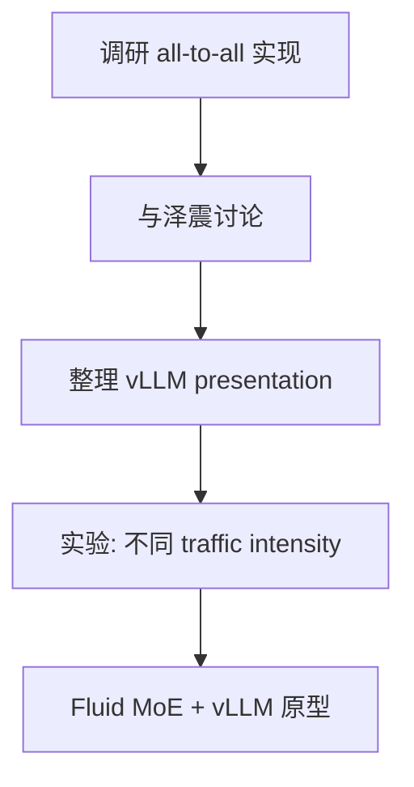

# Professor's Problem

decode step结束之后具体传递的信息？的量和job size (context length) 有没有关系？

discreate markov chain? continuous markov chain?
同步传输？异步传输？


# Note

task: 找泽震聊一下

task: **communication cost / all to all**

task: vllm里面对于all to all的实现是同步的还是异步的

对于知识对齐

单个 expert 有多大
缓存有多大


**缓存和expert的关系**

控制上游traffic的量
不同traffic intensity底下有不一样的结果


调整fluid moe vllm scheduler分配给gpu的intensity

give vllm system presentation


---
## 🤖 Assistant

我来帮你整理这份会议记录。首先让我在 Zotero 中找到这篇论文，以便更好地理解会议内容的背景。

根据论文内容和你的会议记录，我帮你整理成结构化的会议纪要：

---

# 📋 会议记录整理：MoE Serving & vLLM 改进讨论

**日期**：2026年2月14日
**形式**：线上会议 (Online Meeting)
**主题**：
1. 论文《Efficient MoE Serving in the Memory-Bound Regime: Balance Activated Experts, Not Tokens》理解与讨论
2. 基于 vLLM 模块的改进方案

---

## 一、论文核心观点回顾

| 要点 | 内容 |
|------|------|
| **核心问题** | Expert Parallelism (EP) 中 GPU 负载不均衡 |
| **传统方法** | 平衡每个 GPU 处理的 token 数量 (EPLB) |
| **论文发现** | 在 memory-bound 场景（尤其 decode 阶段），平衡 token 反而降低性能 |
| **提出的方案** | **METRO**: 平衡 activated experts 数量，而非 token 数量 |
| **关键技术** | 使用 allGather 而非 allToAll 收集 global top-k 知识 |

---

## 二、教授提出的问题 (Professor's Questions)

### 🔹 问题1：Decode Step 的信息传递机制
> **"decode step 结束之后具体传递的信息？的量和 job size (context length) 有没有关系？"**

- 关注点：decode 阶段完成后，GPU 间传递的信息量是否与上下文长度相关
- 涉及：通信开销与序列长度的关系分析

### 🔹 问题2：Markov Chain 建模
> **"discrete markov chain? continuous markov chain?"**

- 关注点：系统行为建模方式的选择
- 可能方向：专家激活模式的随机过程建模

### 🔹 问题3：通信同步机制
> **"同步传输？异步传输？"**

- 关注点：all-to-all 通信的实现方式
- 与 vLLM 实现的关联

---

## 三、讨论要点与待办任务 (Action Items)

### 🎯 优先级任务

| 优先级 | 任务 | 负责人 | 说明 |
|--------|------|--------|------|
| **高** | **调研 communication cost / all-to-all** | - | 分析通信开销，特别是 all-to-all 实现的同步/异步特性 |
| **高** | **确认 vLLM 中 all-to-all 实现方式** | - | 确定当前 vLLM 是同步还是异步实现 |
| **中** | **与泽震讨论** | - | 待沟通事项（可能是技术方案对接） |
| **中** | **准备 vLLM system presentation** | - | 向团队/教授展示 vLLM 架构 |

### 🔍 技术调研方向

| 方向 | 具体问题 |
|------|----------|
| **缓存与 Expert 关系** | 单个 expert 有多大？缓存有多大？缓存和 expert 的关系是什么？ |
| **知识对齐** | 如何实现知识的有效对齐？ |
| **流量控制** | 如何控制上游 traffic 的量？不同 traffic intensity 下的表现差异？ |

### 💡 潜在研究思路

1. **Fluid MoE + vLLM Scheduler 结合**
 - 调整分配给 GPU 的 intensity
 - 根据 workload 动态优化

2. **动态负载均衡策略**
 - 不同 traffic intensity 下采用不同策略
 - 考虑 decode/pre-fill 混合部署场景

---

## 四、待澄清问题

以下问题需要进一步调研后回复教授：

| # | 问题 | 建议调研路径 |
|---|------|-------------|
| 1 | Decode step 传递信息量与 context length 的关系 | 分析 vLLM 中 attention 状态传递机制 |
| 2 | Markov chain 建模的适用性 | 阅读论文中关于专家激活模式的分析部分 |
| 3 | 同步 vs 异步 all-to-all | 查看 vLLM MoE 实现源码 (custom all-to-all kernel) |
| 4 | Expert 大小与缓存配置 | 查阅 DeepSeek-V3/Qwen3 模型配置 |

---

## 五、下一步计划



![[Pasted image 20260214170132.png]]


---
## 🤖 Assistant

我来整理这个新 idea 的讨论内容：

---

## 六、核心 Idea：自适应 Expert 调度策略

### 6.1 核心洞察 (Core Insight)

**METRO 的本质**：通过将 expert 加载到 GPU Cache 后**持续复用**，减少 FFN 计算时间，从而降低 memory traffic。

```
传统 EPLB:  分散 expert → 每个 GPU 加载更多 expert → 频繁 reload → memory traffic ↑
METRO:      集中 expert → 单个 GPU 复用同一 expert → 减少 reload → memory traffic ↓
```

---

### 6.2 新的调度策略 (Ryan's Proposal)

> **关键观察**：单纯的"找最小队列"策略可能不是最优的，需要基于系统状态动态调整。

#### 自适应调度规则

| 条件 | 策略 | 目的 |
|------|------|------|
| **Q_d(t) < q** | 找**最大**的队列 | 利用 batch 加速，填满带宽到 memory bound 点 |
| **全部 Q_d(t) > q** | 找**最小**的队列 | 负载均衡，避免单个 GPU 过载 |

#### 参数定义
- **Q_d(t)**: GPU d 在时间 t 的队列长度（待处理 token 数）
- **q**: 阈值常数，表示**使带宽打满的最大 batch size**（memory bound 临界点）

---

### 6.3 硬件约束分析

| 约束 | 具体数据 | 影响 |
|------|---------|------|
| SRAM 容量 | A100 仅 40MB | 无法缓存大量 expert |
| Expert 缓存 | 小 expert 也只能装 **3-5 个** | 处理 batch 时必须频繁 reload |
| 搬运成本 | 每次 reload 都有显著开销 | 这是主要性能瓶颈 |

> **结论**：处理一个 batch 一定会不断重新 reload 专家，搬运成本是核心优化目标。

---

### 6.4 Batch Size 的权衡 (The Trade-off)

```
┌─────────────────────────────────────────────────────────┐
│  Small Batch                    Large Batch             │
│  ━━━━━━━━━━━━━                  ━━━━━━━━━━━━             │
│                                                          │
│  • Expert 复用概率高            • 需要用到太多不同专家      │
│  • 集中在一个 GPU 收益大         • 不得不 reload 很多参数   │
│  • → 采用 METRO 策略            • 集中在一个 GPU 反而不好   │
│                                 • → 需要分散到多个 GPU    │
│                                                          │
│  [复用优先]                      [并行优先]               │
└─────────────────────────────────────────────────────────┘
```

#### 动态策略建议

| Batch 规模 | Expert 分布策略 | 理由 |
|-----------|----------------|------|
| **小 Batch** | 集中 (Colocate) | Expert 复用率高，减少 reload |
| **大 Batch** | 分散 (Distribute) | 需要加载更多不同 expert，分散并行更有利 |

---

### 6.5 与 vLLM 集成的潜在方向

```
┌────────────────────────────────────────┐
│         vLLM Scheduler                 │
│  ┌────────────────────────────────┐    │
│  │  1. 监控当前 batch size        │    │
│  │  2. 评估 expert 复用概率       │    │
│  │  3. 动态选择 routing 策略      │    │
│  └────────────────────────────────┘    │
│              ↓                         │
│    ┌─────────┴─────────┐               │
│    ↓                   ↓               │
│  小batch             大batch            │
│    ↓                   ↓               │
│  METRO-like        EPLB-like           │
│  (expert集中)      (token均衡)          │
│    ↓                   ↓               │
│  减少reload         并行加载            │
└────────────────────────────────────────┘
```

---

### 6.6 待验证问题

| # | 问题 | 验证方法 |
|---|------|---------|
| 1 | q 阈值的具体数值如何确定？ | 基于 A100 HBM 带宽和 expert 大小的计算 |
| 2 | 如何判断"小 batch" vs "大 batch"的临界点？ | 实验：不同 batch size 下的 throughput 曲线 |
| 3 | 动态切换策略的开销？ | 测量 scheduling 决策时间 vs 收益 |
| 4 | 与现有 vLLM PD-disaggregation 的兼容性？ | 代码分析和原型测试 |

---

### 6.7 下一步行动

```markdown
1. [ ] 复现 METRO 实验，验证 batch size 对性能的影响曲线
2. [ ] 在 vLLM 中实现 adaptive routing 原型
3. [ ] 确定小模型（如 Qwen3-0.6B MoE）的 q 阈值
4. [ ] 与泽震讨论实现可行性，特别是 all-to-all kernel 的修改
```

