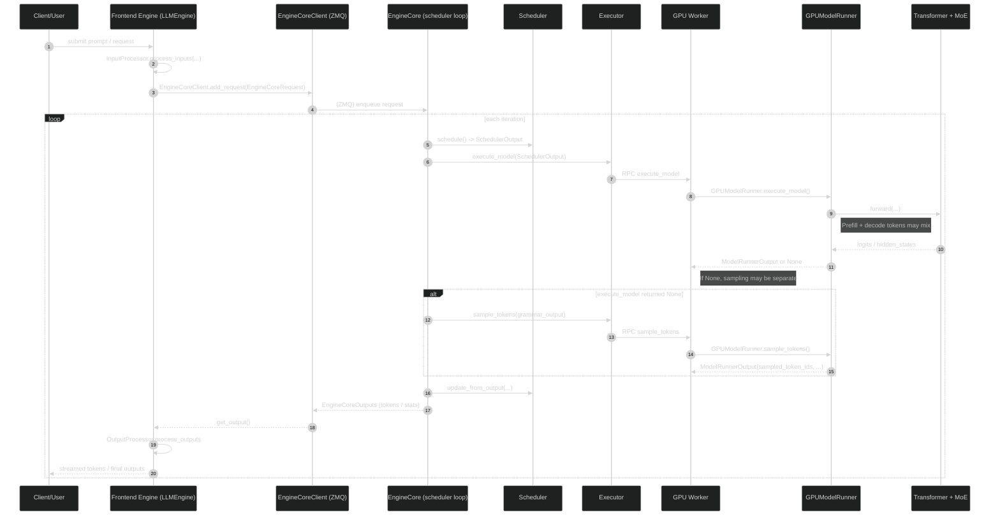
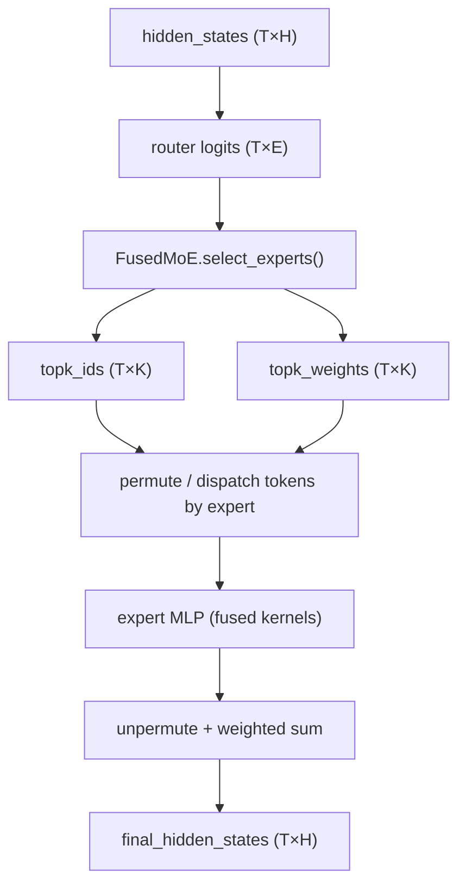

# vLLM MoE Inference Walkthrough (v0.13.0)

> Scope: This note is a code-guided walkthrough of how vLLM executes **Mixture-of-Experts (MoE)** inference in the **v1 engine** (the default in v0.13.0), and what our local patches add (Experiment E1.1 routing statistics).
>
> Codebase location in this repo: `external/vllm/` (symlink). The upstream repo is checked out at `~/sthmax/git/vllm`.

## 0) Quick module map (where to read)

### Request lifecycle (front-end → engine core)

- `external/vllm/vllm/v1/engine/llm_engine.py`
  - `LLMEngine.add_request(...)`: converts user input → `EngineCoreRequest`, then sends to EngineCore.
  - `LLMEngine.step()`: pulls `EngineCoreOutputs`, detokenizes, returns `RequestOutput`s.
- `external/vllm/vllm/v1/engine/core_client.py`
  - `EngineCoreClient.add_request(...)` / `get_output(...)`: IPC (ZMQ) between Python “frontend engine” and “engine core”.
- `external/vllm/vllm/v1/engine/core.py`
  - `EngineCore.step()`: the **inner loop**: schedule → execute → sample → update scheduler → produce outputs.

### Scheduling and KV-cache management

- `external/vllm/vllm/v1/core/sched/scheduler.py`
  - `Scheduler.schedule()`: decides which tokens (prompt+decode) to run this iteration.
- `external/vllm/vllm/v1/core/sched/output.py`
  - `SchedulerOutput`: the “batch plan” sent to workers each iteration.

### Worker-side model execution

- `external/vllm/vllm/v1/executor/abstract.py`
  - `Executor.execute_model(...)` / `sample_tokens(...)`: RPC abstraction.
- `external/vllm/vllm/v1/executor/uniproc_executor.py`
  - `UniProcExecutor.execute_model(...)`: local single-process executor implementation.
- `external/vllm/vllm/v1/worker/gpu_worker.py`
  - `Worker.shutdown()`: worker lifecycle and our flush hook.
- `external/vllm/vllm/v1/worker/gpu/model_runner.py`
  - `GPUModelRunner.execute_model(...)`: prepare inputs + forward (may return None and defer sampling).
  - `GPUModelRunner.sample_tokens(...)`: token sampling step.
- `external/vllm/vllm/v1/worker/gpu_model_runner.py`
  - `GPUModelRunner._execute_model(...)` (large file): the other GPU runner path used by some configurations.

### MoE layer / fused kernels

- `external/vllm/vllm/model_executor/layers/fused_moe/layer.py`
  - `FusedMoE.select_experts(...)`: computes Top-k routing (our stats hook lives here).
  - `FusedMoE.forward_native(...)` / `FusedMoE.forward_cuda(...)`: calls `torch.ops.vllm.moe_forward(...)`.
  - `moe_forward_shared(...)`: shared-experts path (our stats hook also here).
- `external/vllm/vllm/_custom_ops.py`
  - `moe_wna16_marlin_gemm(...)`: wrapper around compiled `_moe_C` op (we added an ABI-compat fallback).

---

## 1) Request lifecycle (textual, line-by-line; code-grounded)

This chapter is a fully textual, end-to-end trace of “one request flows through vLLM v1 engine”, with exact file/line anchors and representative code excerpts.

> Note: there are two deployment modes for EngineCore:
> - **Inproc**: EngineCore runs in the same process (debug / V0-style loop)
> - **Multiprocess**: EngineCore runs in a background process, frontend talks via ZMQ (typical production)
>
> The frontend `LLMEngine` code is the same; the concrete `EngineCoreClient` implementation differs.

### 1.1 Frontend receives a request: `LLMEngine.add_request`

File: `external/vllm/vllm/v1/engine/llm_engine.py:L222-L282`

Key effect: converts raw prompt to an `EngineCoreRequest`, then calls `self.engine_core.add_request(...)`.

```python
def add_request(
  self,
  request_id: str,
  prompt: EngineCoreRequest | PromptType,
  params: SamplingParams | PoolingParams,
  arrival_time: float | None = None,
  lora_request: LoRARequest | None = None,
  tokenization_kwargs: dict[str, Any] | None = None,
  trace_headers: Mapping[str, str] | None = None,
  priority: int = 0,
  prompt_text: str | None = None,
) -> None:
  # Validate the request_id type.
  if not isinstance(request_id, str):
    raise TypeError(f"request_id must be a string, got {type(request_id)}")

  # Process raw inputs into the request.
  if isinstance(prompt, EngineCoreRequest):
    request = prompt
  else:
    assert prompt_text is None
    request = self.input_processor.process_inputs(
      request_id,
      prompt,
      params,
      arrival_time,
      lora_request,
      tokenization_kwargs,
      trace_headers,
      priority,
    )
    if isinstance(prompt, str):
      prompt_text = prompt
    elif isinstance(prompt, Mapping):
      prompt_text = cast(str | None, prompt.get("prompt"))

  # Use cloned params that may have been updated in process_inputs()
  params = request.params

  n = params.n if isinstance(params, SamplingParams) else 1

  if n == 1:
    # Make a new RequestState and queue.
    self.output_processor.add_request(request, prompt_text, None, 0)
    # Add the request to EngineCore.
    self.engine_core.add_request(request)
    return
```

### 1.2 EngineCoreClient selection: `EngineCoreClient.make_client`

File: `external/vllm/vllm/v1/engine/core_client.py:L73-L112`

Key effect: chooses between in-process EngineCore and ZMQ-backed multiprocess EngineCore.

```python
@staticmethod
def make_client(
  multiprocess_mode: bool,
  asyncio_mode: bool,
  vllm_config: VllmConfig,
  executor_class: type[Executor],
  log_stats: bool,
) -> "EngineCoreClient":
  # TODO: support this for debugging purposes.
  if asyncio_mode and not multiprocess_mode:
    raise NotImplementedError(
      "Running EngineCore in asyncio without multiprocessing "
      "is not currently supported."
    )

  if multiprocess_mode and asyncio_mode:
    return EngineCoreClient.make_async_mp_client(
      vllm_config, executor_class, log_stats
    )

  if multiprocess_mode and not asyncio_mode:
    return SyncMPClient(vllm_config, executor_class, log_stats)

  return InprocClient(vllm_config, executor_class, log_stats)
```

### 1.3 In-proc path: `InprocClient.add_request` pushes directly into EngineCore

File: `external/vllm/vllm/v1/engine/core_client.py:L277-L280`

Key effect: preprocesses then calls `EngineCore.add_request(...)` in the same process.

```python
def add_request(self, request: EngineCoreRequest) -> None:
  req, request_wave = self.engine_core.preprocess_add_request(request)
  self.engine_core.add_request(req, request_wave)
```

### 1.4 Multiprocess path: `MPClient.add_request` sends the request over ZMQ

File: `external/vllm/vllm/v1/engine/core_client.py:L747-L750`

Key effect: serializes and sends `EngineCoreRequestType.ADD` to the EngineCore process.

```python
def add_request(self, request: EngineCoreRequest) -> None:
  if self.is_dp:
    self.engines_running = True
  self._send_input(EngineCoreRequestType.ADD, request)
```

### 1.5 Frontend pulls outputs: `LLMEngine.step` → `EngineCoreClient.get_output`

File: `external/vllm/vllm/v1/engine/llm_engine.py:L285-L308`

Key effect: `LLMEngine.step()` is the driving loop: it calls `self.engine_core.get_output()` and turns `EngineCoreOutputs` into user-visible `RequestOutput`s.

```python
def step(self) -> list[RequestOutput | PoolingRequestOutput]:
  if self.should_execute_dummy_batch:
    self.should_execute_dummy_batch = False
    self.engine_core.execute_dummy_batch()
    return []

  # 1) Get EngineCoreOutput from the EngineCore.
  with record_function_or_nullcontext("llm_engine step: get_output"):
    outputs = self.engine_core.get_output()

  # 2) Process EngineCoreOutputs.
  with record_function_or_nullcontext("llm_engine step: process_outputs"):
    iteration_stats = IterationStats() if self.log_stats else None
    processed_outputs = self.output_processor.process_outputs(
      outputs.outputs,
      engine_core_timestamp=outputs.timestamp,
      iteration_stats=iteration_stats,
    )
```

If using multiprocess EngineCore, the “pull” happens by reading from an output queue fed by a background ZMQ receive thread.

File: `external/vllm/vllm/v1/engine/core_client.py:L711-L723`

```python
def get_output(self) -> EngineCoreOutputs:
    # If an exception arises in process_outputs_socket task,
    # it is forwarded to the outputs_queue so we can raise it
    # from this (run_output_handler) task to shut down the server.
    outputs = self.outputs_queue.get()
    if isinstance(outputs, Exception):
        raise self._format_exception(outputs) from None
    if outputs.wave_complete is not None:
        self.engines_running = False
    return outputs
```

### 1.6 EngineCore inner loop: `EngineCore.step` schedules, executes, samples, updates

File: `external/vllm/vllm/v1/engine/core.py:L336-L369`

Key effect: this is the “one iteration” execution trace.

```python
def step(self) -> tuple[dict[int, EngineCoreOutputs], bool]:
    """Schedule, execute, and make output.

    Returns tuple of outputs and a flag indicating whether the model
    was executed.
    """

    # Check for any requests remaining in the scheduler - unfinished,
    # or finished and not yet removed from the batch.
    if not self.scheduler.has_requests():
        return {}, False
    scheduler_output = self.scheduler.schedule()
    future = self.model_executor.execute_model(scheduler_output, non_block=True)
    grammar_output = self.scheduler.get_grammar_bitmask(scheduler_output)
    with self.log_error_detail(scheduler_output):
        model_output = future.result()
        if model_output is None:
            model_output = self.model_executor.sample_tokens(grammar_output)

    # Before processing the model output, process any aborts that happened
    # during the model execution.
    self._process_aborts_queue()
    engine_core_outputs = self.scheduler.update_from_output(
        scheduler_output, model_output
    )

    return engine_core_outputs, scheduler_output.total_num_scheduled_tokens > 0
```

### 1.7 Scheduler decides which tokens to run: `Scheduler.schedule`

File: `external/vllm/vllm/v1/core/sched/scheduler.py:L216-L244`

Key effect: v1 scheduling is “tokens to catch up under a global token budget”, not a hard prefill-then-decode split.

```python
def schedule(self) -> SchedulerOutput:
    # NOTE(woosuk) on the scheduling algorithm:
    # There's no "decoding phase" nor "prefill phase" in the scheduler.
    # Each request just has the num_computed_tokens and
    # num_tokens_with_spec. num_tokens_with_spec =
    # len(prompt_token_ids) + len(output_token_ids) + len(spec_token_ids).
    # At each step, the scheduler tries to assign tokens to the requests
    # so that each request's num_computed_tokens can catch up its
    # num_tokens_with_spec.

    scheduled_new_reqs: list[Request] = []
    scheduled_resumed_reqs: list[Request] = []
    scheduled_running_reqs: list[Request] = []
    preempted_reqs: list[Request] = []

    req_to_new_blocks: dict[str, KVCacheBlocks] = {}
    num_scheduled_tokens: dict[str, int] = {}
    token_budget = self.max_num_scheduled_tokens
```

### 1.8 Executor RPC boundary: `Executor.execute_model`

File: `external/vllm/vllm/v1/executor/abstract.py:L200-L206`

```python
def execute_model(
  self, scheduler_output: SchedulerOutput, non_block: bool = False
) -> ModelRunnerOutput | None | Future[ModelRunnerOutput | None]:
  output = self.collective_rpc(  # type: ignore[call-overload]
    "execute_model", args=(scheduler_output,), non_block=non_block
  )
  return output[0]
```

### 1.9 Worker-side GPU forward + MoE entrypoints (where MoE stats hook attaches)

Per-token phase mask injection point (E1.1):

File: `external/vllm/vllm/v1/worker/gpu/model_runner.py:L916-L964` (excerpt)

```python
if os.environ.get("VLLM_MOE_STATS_DIR"):
  try:
    from vllm import moe_stats as _moe_stats

    mask = torch.zeros(
      int(input_batch.num_tokens_after_padding),
      dtype=torch.bool,
      device=input_batch.input_ids.device,
    )
    computed_prefill = self.req_states.num_computed_prefill_tokens[
      input_batch.idx_mapping_np
    ]
    prefill_len = self.req_states.prefill_len.np[input_batch.idx_mapping_np]
    is_decode_req = computed_prefill >= prefill_len
    for i, is_decode in enumerate(is_decode_req):
      if not bool(is_decode):
        continue
      s = int(input_batch.query_start_loc_np[i])
      e = int(input_batch.query_start_loc_np[i + 1])
      if 0 <= s < e <= mask.numel():
        mask[s:e] = True
    _moe_stats.set_token_phase_mask(mask)
  except Exception:
    try:
      from vllm import moe_stats as _moe_stats

      _moe_stats.debug_mark_set_mask_failed(stage=10)
    except Exception:
      pass
    pass
hidden_states = self.cudagraph_manager.run(
  input_batch.num_tokens_after_padding
)
```

Routing capture point:

File: `external/vllm/vllm/model_executor/layers/fused_moe/layer.py:L1523-L1680` (excerpt)

```python
try:
  from vllm.moe_stats import record_topk

  record_topk(
    layer_name=self.layer_name,
    topk_ids=topk_ids,
    num_experts=int(router_logits.shape[-1]),
    k_experts=int(self.top_k),
  )
except Exception:
  pass
```

Fused MoE kernel entrypoint:

File: `external/vllm/vllm/model_executor/layers/fused_moe/layer.py:L1711-L1745` (excerpt)

```python
fused_output = torch.ops.vllm.moe_forward(
  hidden_states, router_logits, self.layer_name
)
```

---

## 2) End-to-end inference timeline (what happens per request)

Below is the “one request becomes many batched steps” story.

### 2.1 High-level sequence diagram



### 2.2 The concrete “inner loop” in code

The most important “ground truth” is `EngineCore.step()` in:

- `external/vllm/vllm/v1/engine/core.py`
  - `EngineCore.step()`:
    1) `scheduler_output = self.scheduler.schedule()`
    2) `future = self.model_executor.execute_model(scheduler_output, non_block=True)`
    3) `grammar_output = self.scheduler.get_grammar_bitmask(scheduler_output)`
    4) `model_output = future.result()`
       - if `None`, call `self.model_executor.sample_tokens(grammar_output)`
    5) `engine_core_outputs = self.scheduler.update_from_output(scheduler_output, model_output)`

This split (execute_model vs sample_tokens) is why, when reading worker code, you’ll see `execute_model()` often **prepare+run forward**, then stash state, then `sample_tokens()` consumes it.

---

## 3) Scheduling semantics: vLLM v1 does NOT have a strict “prefill phase”

A key modeling detail: v1 scheduler treats work as “tokens to catch up”, not as two disjoint phases.

In `external/vllm/vllm/v1/core/sched/scheduler.py`, `Scheduler.schedule()` explicitly states:

- There’s no separate decoding/prefill phase in the scheduler
- Each request has `num_computed_tokens` and a target `num_tokens_with_spec`
- Each iteration schedules some number of new tokens per request under a global token budget

Practical consequence:

- A **single forward** can mix:
  - requests that schedule **1 token** (classic decode)
  - requests that schedule **many tokens** (chunked prefill)

This is *the reason* our E1.1 routing stats instrumentation needs a **per-token “decode vs prefill” mask** instead of a single phase flag.

---

## 4) Worker execution: how SchedulerOutput becomes a GPU forward

### 4.1 What SchedulerOutput contains

`external/vllm/vllm/v1/core/sched/output.py` defines `SchedulerOutput`. Conceptually it’s the per-iteration “batch plan” and includes:

- `scheduled_new_reqs`: first-time requests (send full prompt + metadata)
- `scheduled_cached_reqs`: previously seen requests (send only deltas)
- `num_scheduled_tokens`: per request how many tokens to run this step
- `total_num_scheduled_tokens`: summed tokens for the batch
- `finished_req_ids`: requests that finished since last step
- KV-cache block ids / bookkeeping (block tables, connector metadata)

### 4.2 How GPUModelRunner uses that plan

There are two relevant GPU runner implementations in v0.13.0:

1) The smaller v1 runner:
- `external/vllm/vllm/v1/worker/gpu/model_runner.py`
  - `GPUModelRunner.execute_model(...)`
  - `GPUModelRunner.sample_tokens(...)`

2) The larger runner file (used by some configs / features):
- `external/vllm/vllm/v1/worker/gpu_model_runner.py`

Both follow the same conceptual pattern:

- Deserialize/assemble input batch tensors (input_ids, positions, attention metadata)
- Bind KV cache blocks for each request
- Run model forward (eager or CUDA graph)
- Sample tokens (in a separate call in the v1 loop)

---

## 5) Inside the model: what “MoE execution” means in vLLM

In vLLM, “MoE execution” is not a separate engine stage—it happens inside the Transformer forward when it reaches an MoE MLP block.

### 5.1 MoE routing and fused execution (key functions)

The MoE layer implementation of interest is the fused MoE custom op:

- `external/vllm/vllm/model_executor/layers/fused_moe/layer.py`
  - `class FusedMoE(CustomOp)`
  - `FusedMoE.select_experts(hidden_states, router_logits)`
    - computes `topk_weights, topk_ids` (Top-k routing)
    - may apply EPLB mapping when enabled
  - `FusedMoE.forward_native(hidden_states, router_logits)`
    - calls `torch.ops.vllm.moe_forward(hidden_states, router_logits, layer_name)`
    - (shared experts variant calls `torch.ops.vllm.moe_forward_shared(...)`)

A simplified picture of the dataflow is:



Notes:

- The fused path tries to **avoid Python overhead** and uses compiled/triton kernels.
- With expert parallelism (EP), the dispatch/compute/combine can involve **collectives** (e.g., all-to-all) depending on configured backend.

---

## 6) Our vLLM modifications: what we changed and why it matters

We made changes for two purposes:

1) **Experiment E1.1**: collect MoE routing / expert activation statistics from real runs.
2) **Build compatibility**: avoid crashing when Python wrapper signature mismatches a prebuilt C++ extension.

### 6.1 New stats collector module

- Added: `external/vllm/vllm/moe_stats.py`
  - Environment-gated, best-effort collector.
  - Writes one `.npz` per process with per-layer counts.

Enable it with:

- `VLLM_MOE_STATS_DIR=/path/to/write/npz`
- (optional) `VLLM_MOE_STATS_DOMAIN=your_domain_name`
- (optional) `VLLM_MOE_STATS_ALL_RANKS=1` to write from all ranks (default is rank0 only).

### 6.2 Hook routing decisions at the source: `FusedMoE.select_experts`

- Modified: `external/vllm/vllm/model_executor/layers/fused_moe/layer.py`
  - In `FusedMoE.select_experts(...)`, after `topk_ids` is produced, we call:
    - `vllm.moe_stats.record_topk(layer_name, topk_ids, num_experts, k_experts)`
  - In `moe_forward_shared(...)`, we call:
    - `vllm.moe_stats.record_shared(layer_name, num_tokens)`

Why this location is important:

- It captures the **actual routing outcome** (top-k expert IDs) used by the fused kernels.
- It’s model-agnostic: any MoE model using `FusedMoE` is covered.

### 6.3 Correct phase-splitting requires a per-token mask (v1 mixed batches)

- Modified: `external/vllm/vllm/v1/worker/gpu/model_runner.py`
  - Around the forward call inside `GPUModelRunner.execute_model(...)`, we build a boolean mask of length `num_tokens_after_padding`:
    - `True` for decode tokens, `False` for prefill tokens.
  - We call `moe_stats.set_token_phase_mask(mask)` before forward, and clear it after forward.

- Modified: `external/vllm/vllm/v1/worker/gpu_model_runner.py`
  - Similar mask creation based on packed `(req-major, position)` token order.
  - Uses `try/finally` to guarantee the mask is cleared.
  - Wraps some non-inference forwards with `moe_stats.pause()` / `resume()` to avoid contaminating stats.

Why it matters:

- Without this, any “prefill vs decode” split would be wrong whenever v1 schedules mixed batches.
- With it, the stats file contains:
  - `cnt_topk_prefill/cnt_topk_decode`, `cnt_top1_prefill/cnt_top1_decode`, and token counts for each.

### 6.4 Flush stats reliably on worker shutdown

- Modified: `external/vllm/vllm/v1/worker/gpu_worker.py`
  - In `Worker.shutdown()`, call `moe_stats.flush(reason="worker_shutdown")`.

Why it matters:

- Some termination paths are abrupt; relying on only `atexit` can lose partial outputs.

### 6.5 Make custom op wrapper compatible across builds

- Modified: `external/vllm/vllm/_custom_ops.py`
  - In `moe_wna16_marlin_gemm(...)`, we try the 30-arg call first (with `is_ep`), and if the underlying op reports it only accepts 29 args, we retry without `is_ep`.

Why it matters:

- On some machines, `_moe_C` is precompiled with an older schema. This prevents a hard crash like:
  - `expected at most 29 argument(s) but received 30`

### 6.6 Device-specific fused MoE tuning config (A100)

- Added: `external/vllm/vllm/model_executor/layers/fused_moe/configs/E=128,N=192,device_name=NVIDIA_A100-SXM4-40GB.json`

What it is:

- A Triton tuning cache / config blob for a specific MoE shape (E=128 experts, N=192 intermediate) on A100.

Why it matters:

- Reduces kernel autotuning overhead / stabilizes performance for that configuration.

---

## 7) 可观测量 / 可控变量 / 约束候选清单（vLLM-grounded）

This section bridges “what vLLM actually does” to “what we can model/optimize” in an OR / fluid / queueing abstraction.

### 7.1 可观测量（Observables）

- Scheduler / batching (per-step)
  - `SchedulerOutput.total_num_scheduled_tokens` (batch size proxy)
  - `token_budget = self.max_num_scheduled_tokens` (hard per-step cap)
  - Mix structure: which requests get `num_scheduled_tokens == 1` (decode-ish) vs `> 1` (prefill-ish)
- Request backlog / progress
  - `request.num_tokens_with_spec + request.num_output_placeholders - request.num_computed_tokens` (a token-backlog proxy)
- KV cache / memory pressure
  - New blocks requested per step (`req_to_new_blocks`) and allocation pressure from `KVCacheManager`
- MoE routing / expert activation
  - From our `.npz`: per-layer per-expert counts (Top-1/Top-k), plus prefill/decode split when the per-token phase mask is set

### 7.2 可控变量（Controls / knobs you can change）

- Scheduling policy knobs
  - `max_num_scheduled_tokens` (throughput/latency tradeoff)
  - `long_prefill_token_threshold` (how aggressively prompts are chunked)
- Admission / prioritization knobs
  - `LLMEngine.add_request(..., priority=...)`
- MoE-layer knobs (model-dependent but surfaced in `FusedMoE`)
  - `top_k`, `use_grouped_topk`, and (when supported) `enable_eplb`

### 7.3 约束候选（Constraint candidates）

- Per-step compute capacity
  - Map to vLLM: token budget (`max_num_scheduled_tokens`)
  - Candidate: sum of scheduled tokens per step is capped
- Per-request max-length
  - Map to vLLM: scheduler clamps `num_new_tokens` against `max_model_len`
  - Candidate: remaining tokens for a request is bounded by model length
- KV cache capacity
  - Map to vLLM: total KV blocks are finite; allocation failures drive preemption/latency
  - Candidate: total KV blocks reserved across active requests is capped
- Expert capacity / skew
  - Map to vLLM: observed per-expert activations (from `.npz`)
  - Candidate: either hard cap per expert (capacity) or penalty on load variance (skew)

---

## Appendix A: How to validate the instrumentation quickly

1) Run a small vLLM job with MoE model and export directory set:

- `export VLLM_MOE_STATS_DIR=/tmp/vllm_moe_stats`
- `export VLLM_MOE_STATS_DOMAIN=smoke`

2) After run, verify `.npz` appears:

- `/tmp/vllm_moe_stats/routing_smoke_rank0_pidXXXX.npz`

3) Sanity checks (quick):

- `cnt_topk.sum(axis=1)` should be approximately `tokens_processed * k_experts`
- `tokens_prefill + tokens_decode` should be close to `tokens_processed` (mask debug counters help diagnose mismatches)

