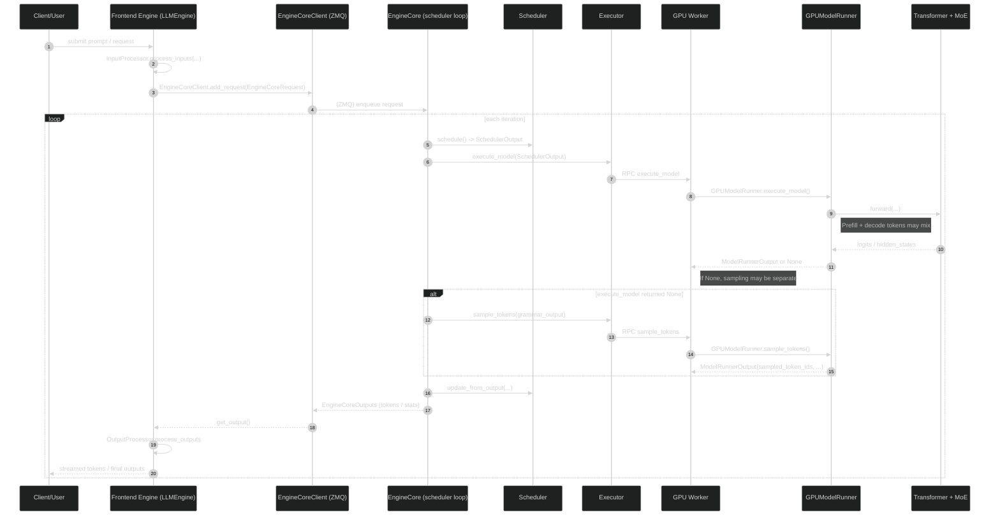

# vLLM MoE Inference Walkthrough (v0.13.0)

> Scope: This note is a code-guided walkthrough of how vLLM executes **Mixture-of-Experts (MoE)** inference in the **v1 engine** (the default in v0.13.0), and what our local patches add (Experiment E1.1 routing statistics).
>
> Codebase location in this repo: `external/vllm/` (symlink). The upstream repo is checked out at `~/sthmax/git/vllm`.

## 0) Quick module map (where to read)

### Request lifecycle (front-end → engine core)

- `external/vllm/vllm/v1/engine/llm_engine.py`
  - `LLMEngine.add_request(...)`: converts user input → `EngineCoreRequest`, then sends to EngineCore.
  - `LLMEngine.step()`: pulls `EngineCoreOutputs`, detokenizes, returns `RequestOutput`s.
- `external/vllm/vllm/v1/engine/core_client.py`
  - `EngineCoreClient.add_request(...)` / `get_output(...)`: IPC (ZMQ) between Python “frontend engine” and “engine core”.
- `external/vllm/vllm/v1/engine/core.py`
  - `EngineCore.step()`: the **inner loop**: schedule → execute → sample → update scheduler → produce outputs.

### Scheduling and KV-cache management

- `external/vllm/vllm/v1/core/sched/scheduler.py`
  - `Scheduler.schedule()`: decides which tokens (prompt+decode) to run this iteration.
- `external/vllm/vllm/v1/core/sched/output.py`
  - `SchedulerOutput`: the “batch plan” sent to workers each iteration.

### Worker-side model execution

- `external/vllm/vllm/v1/executor/abstract.py`
  - `Executor.execute_model(...)` / `sample_tokens(...)`: RPC abstraction.
- `external/vllm/vllm/v1/executor/uniproc_executor.py`
  - `UniProcExecutor.execute_model(...)`: local single-process executor implementation.
- `external/vllm/vllm/v1/worker/gpu_worker.py`
  - `Worker.shutdown()`: worker lifecycle and our flush hook.
- `external/vllm/vllm/v1/worker/gpu/model_runner.py`
  - `GPUModelRunner.execute_model(...)`: prepare inputs + forward (may return None and defer sampling).
  - `GPUModelRunner.sample_tokens(...)`: token sampling step.
- `external/vllm/vllm/v1/worker/gpu_model_runner.py`
  - `GPUModelRunner._execute_model(...)` (large file): the other GPU runner path used by some configurations.

### MoE layer / fused kernels

- `external/vllm/vllm/model_executor/layers/fused_moe/layer.py`
  - `FusedMoE.select_experts(...)`: computes Top-k routing (our stats hook lives here).
  - `FusedMoE.forward_native(...)` / `FusedMoE.forward_cuda(...)`: calls `torch.ops.vllm.moe_forward(...)`.
  - `moe_forward_shared(...)`: shared-experts path (our stats hook also here).
- `external/vllm/vllm/_custom_ops.py`
  - `moe_wna16_marlin_gemm(...)`: wrapper around compiled `_moe_C` op (we added an ABI-compat fallback).

---

## 1) End-to-end inference timeline (what happens per request)

Below is the “one request becomes many batched steps” story.

### 1.1 High-level sequence diagram



### 1.2 The concrete “inner loop” in code

The most important “ground truth” is `EngineCore.step()` in:

- `external/vllm/vllm/v1/engine/core.py`
  - `EngineCore.step()`:
    1) `scheduler_output = self.scheduler.schedule()`
    2) `future = self.model_executor.execute_model(scheduler_output, non_block=True)`
    3) `grammar_output = self.scheduler.get_grammar_bitmask(scheduler_output)`
    4) `model_output = future.result()`
       - if `None`, call `self.model_executor.sample_tokens(grammar_output)`
    5) `engine_core_outputs = self.scheduler.update_from_output(scheduler_output, model_output)`

This split (execute_model vs sample_tokens) is why, when reading worker code, you’ll see `execute_model()` often **prepare+run forward**, then stash state, then `sample_tokens()` consumes it.

---

## 2) Scheduling semantics: vLLM v1 does NOT have a strict “prefill phase”

A key modeling detail: v1 scheduler treats work as “tokens to catch up”, not as two disjoint phases.

In `external/vllm/vllm/v1/core/sched/scheduler.py`, `Scheduler.schedule()` explicitly states:

- There’s no separate decoding/prefill phase in the scheduler
- Each request has `num_computed_tokens` and a target `num_tokens_with_spec`
- Each iteration schedules some number of new tokens per request under a global token budget

Practical consequence:

- A **single forward** can mix:
  - requests that schedule **1 token** (classic decode)
  - requests that schedule **many tokens** (chunked prefill)

This is *the reason* our E1.1 routing stats instrumentation needs a **per-token “decode vs prefill” mask** instead of a single phase flag.

---

## 3) Worker execution: how SchedulerOutput becomes a GPU forward

### 3.1 What SchedulerOutput contains

`external/vllm/vllm/v1/core/sched/output.py` defines `SchedulerOutput`. Conceptually it’s the per-iteration “batch plan” and includes:

- `scheduled_new_reqs`: first-time requests (send full prompt + metadata)
- `scheduled_cached_reqs`: previously seen requests (send only deltas)
- `num_scheduled_tokens`: per request how many tokens to run this step
- `total_num_scheduled_tokens`: summed tokens for the batch
- `finished_req_ids`: requests that finished since last step
- KV-cache block ids / bookkeeping (block tables, connector metadata)

### 3.2 How GPUModelRunner uses that plan

There are two relevant GPU runner implementations in v0.13.0:

1) The smaller v1 runner:
- `external/vllm/vllm/v1/worker/gpu/model_runner.py`
  - `GPUModelRunner.execute_model(...)`
  - `GPUModelRunner.sample_tokens(...)`

2) The larger runner file (used by some configs / features):
- `external/vllm/vllm/v1/worker/gpu_model_runner.py`

Both follow the same conceptual pattern:

- Deserialize/assemble input batch tensors (input_ids, positions, attention metadata)
- Bind KV cache blocks for each request
- Run model forward (eager or CUDA graph)
- Sample tokens (in a separate call in the v1 loop)

---

## 4) Inside the model: what “MoE execution” means in vLLM

In vLLM, “MoE execution” is not a separate engine stage—it happens inside the Transformer forward when it reaches an MoE MLP block.

### 4.1 MoE routing and fused execution (key functions)

The MoE layer implementation of interest is the fused MoE custom op:

- `external/vllm/vllm/model_executor/layers/fused_moe/layer.py`
  - `class FusedMoE(CustomOp)`
  - `FusedMoE.select_experts(hidden_states, router_logits)`
    - computes `topk_weights, topk_ids` (Top-k routing)
    - may apply EPLB mapping when enabled
  - `FusedMoE.forward_native(hidden_states, router_logits)`
    - calls `torch.ops.vllm.moe_forward(hidden_states, router_logits, layer_name)`
    - (shared experts variant calls `torch.ops.vllm.moe_forward_shared(...)`)

A simplified picture of the dataflow is:

```mermaid
flowchart TD
    HS[hidden_states: (T,H)] --> Router[router logits: (T,E)]
    Router --> TopK[FusedMoE.select_experts]
    TopK --> IDs[topk_ids: (T,K)]
    TopK --> W[topk_weights: (T,K)]
    IDs --> Dispatch[permute/dispatch tokens by expert]
    W --> Dispatch
    Dispatch --> ExpertGEMM[expert MLP (fused kernels)]
    ExpertGEMM --> Combine[unpermute + weighted sum]
    Combine --> Out[final_hidden_states: (T,H)]
```

Notes:

- The fused path tries to **avoid Python overhead** and uses compiled/triton kernels.
- With expert parallelism (EP), the dispatch/compute/combine can involve **collectives** (e.g., all-to-all) depending on configured backend.

---

## 5) Our vLLM modifications: what we changed and why it matters

We made changes for two purposes:

1) **Experiment E1.1**: collect MoE routing / expert activation statistics from real runs.
2) **Build compatibility**: avoid crashing when Python wrapper signature mismatches a prebuilt C++ extension.

### 5.1 New stats collector module

- Added: `external/vllm/vllm/moe_stats.py`
  - Environment-gated, best-effort collector.
  - Writes one `.npz` per process with per-layer counts.

Enable it with:

- `VLLM_MOE_STATS_DIR=/path/to/write/npz`
- (optional) `VLLM_MOE_STATS_DOMAIN=your_domain_name`
- (optional) `VLLM_MOE_STATS_ALL_RANKS=1` to write from all ranks (default is rank0 only).

### 5.2 Hook routing decisions at the source: `FusedMoE.select_experts`

- Modified: `external/vllm/vllm/model_executor/layers/fused_moe/layer.py`
  - In `FusedMoE.select_experts(...)`, after `topk_ids` is produced, we call:
    - `vllm.moe_stats.record_topk(layer_name, topk_ids, num_experts, k_experts)`
  - In `moe_forward_shared(...)`, we call:
    - `vllm.moe_stats.record_shared(layer_name, num_tokens)`

Why this location is important:

- It captures the **actual routing outcome** (top-k expert IDs) used by the fused kernels.
- It’s model-agnostic: any MoE model using `FusedMoE` is covered.

### 5.3 Correct phase-splitting requires a per-token mask (v1 mixed batches)

- Modified: `external/vllm/vllm/v1/worker/gpu/model_runner.py`
  - Around the forward call inside `GPUModelRunner.execute_model(...)`, we build a boolean mask of length `num_tokens_after_padding`:
    - `True` for decode tokens, `False` for prefill tokens.
  - We call `moe_stats.set_token_phase_mask(mask)` before forward, and clear it after forward.

- Modified: `external/vllm/vllm/v1/worker/gpu_model_runner.py`
  - Similar mask creation based on packed `(req-major, position)` token order.
  - Uses `try/finally` to guarantee the mask is cleared.
  - Wraps some non-inference forwards with `moe_stats.pause()` / `resume()` to avoid contaminating stats.

Why it matters:

- Without this, any “prefill vs decode” split would be wrong whenever v1 schedules mixed batches.
- With it, the stats file contains:
  - `cnt_topk_prefill/cnt_topk_decode`, `cnt_top1_prefill/cnt_top1_decode`, and token counts for each.

### 5.4 Flush stats reliably on worker shutdown

- Modified: `external/vllm/vllm/v1/worker/gpu_worker.py`
  - In `Worker.shutdown()`, call `moe_stats.flush(reason="worker_shutdown")`.

Why it matters:

- Some termination paths are abrupt; relying on only `atexit` can lose partial outputs.

### 5.5 Make custom op wrapper compatible across builds

- Modified: `external/vllm/vllm/_custom_ops.py`
  - In `moe_wna16_marlin_gemm(...)`, we try the 30-arg call first (with `is_ep`), and if the underlying op reports it only accepts 29 args, we retry without `is_ep`.

Why it matters:

- On some machines, `_moe_C` is precompiled with an older schema. This prevents a hard crash like:
  - `expected at most 29 argument(s) but received 30`

### 5.6 Device-specific fused MoE tuning config (A100)

- Added: `external/vllm/vllm/model_executor/layers/fused_moe/configs/E=128,N=192,device_name=NVIDIA_A100-SXM4-40GB.json`

What it is:

- A Triton tuning cache / config blob for a specific MoE shape (E=128 experts, N=192 intermediate) on A100.

Why it matters:

- Reduces kernel autotuning overhead / stabilizes performance for that configuration.

---

## 6) What you can measure / control next (for OR ↔ system mapping)

### 6.1 Easy-to-export observables

- Per layer expert activation histogram (from our `.npz`):
  - total / prefill / decode split
- Per step scheduling totals:
  - `SchedulerOutput.total_num_scheduled_tokens`
  - queue sizes / preemption (from scheduler stats)
- KV-cache usage:
  - block allocation pressure (KV cache manager + stats)

### 6.2 Natural control knobs in vLLM (conceptual)

- Scheduling budgets:
  - max batched tokens / max seqs
  - chunked prefill thresholds
- Routing/expert system knobs (model-dependent):
  - top-k, group routing, EPLB settings
- Admission / prioritization:
  - request priority, async scheduling

(These are intentionally high-level; once we decide the exact modeling abstraction, we can map them to precise symbols/constraints.)

---

## Appendix A: How to validate the instrumentation quickly

1) Run a small vLLM job with MoE model and export directory set:

- `export VLLM_MOE_STATS_DIR=/tmp/vllm_moe_stats`
- `export VLLM_MOE_STATS_DOMAIN=smoke`

2) After run, verify `.npz` appears:

- `/tmp/vllm_moe_stats/routing_smoke_rank0_pidXXXX.npz`

3) Sanity checks (quick):

- `cnt_topk.sum(axis=1)` should be approximately `tokens_processed * k_experts`
- `tokens_prefill + tokens_decode` should be close to `tokens_processed` (mask debug counters help diagnose mismatches)

